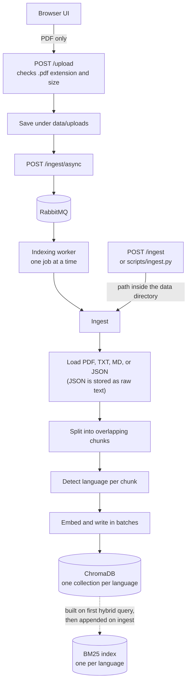
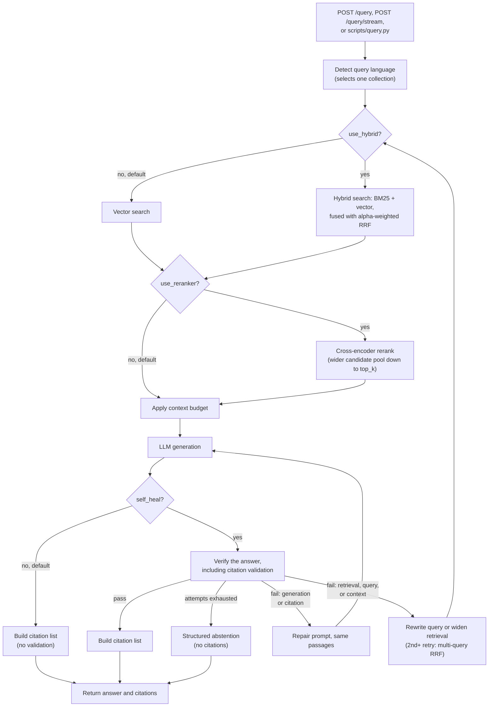

<div align="center">

# Production-Grade RAG Pipeline

**Retrieval-augmented generation as a service: vector-search baseline, optional hybrid retrieval and cross-encoder reranking, multi-provider LLMs, MCP tool exposure, and end-to-end observability.**

[](https://github.com/rajarshidattapy/production_rag/actions/workflows/ci.yml)
[](../LICENSE)

[Quickstart](#quickstart) · [Architecture](#architecture) · [Configuration](#configuration) · [Deployment](#deployment) · [Observability](#observability)

</div>

---

| Layer | Stack |
| :-- | :-- |
| **Core** |    |
| **Retrieval & models** |     |
| **Observability** |    |
| **Async & messaging** |     |
| **Infra & deploy** |      |
| **Cloud** |    |


---

## High-level overview

```
Documents -> Loader -> Chunker -> ChromaDB (dense vectors, per language)
                                     |
                                     +-> BM25 index (built on first hybrid query)

POST /ingest/async -> RabbitMQ -> indexing worker -> Loader (one job at a time)

Query -> Detect language -> Vector search            (default)
                            or Hybrid search         (use_hybrid=true)
                         -> Cross-encoder reranker   (only if use_reranker=true)
                         -> Context budget -> LLM -> Answer + citation list
                         -> Verify and repair        (only if self_heal=true)

MCP clients -> /mcp (read-only) -> search_knowledge_base, ask_knowledge_base, get_passage,
                               get_section, list_documents, knowledge_base_info
```

## Architecture

**Ingestion**



**Query**



Hybrid search, reranking, and self-healing are three independent switches, all off by default. Instrumentation is shown separately in [Monitoring & Observability](#monitoring--observability), because it differs by entry point.


For detailed operations, configuration, deployment, evaluation, and security guidance, see [api.md](api.md), [novelties.md](novelties.md), [feature.md](feature.md), [files.md](files.md), and the source-level documentation.
