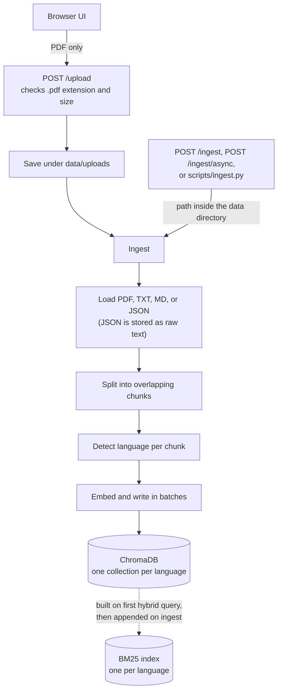
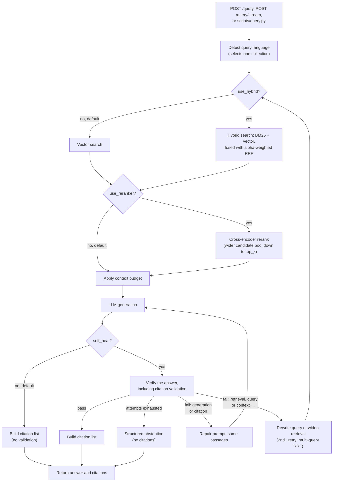
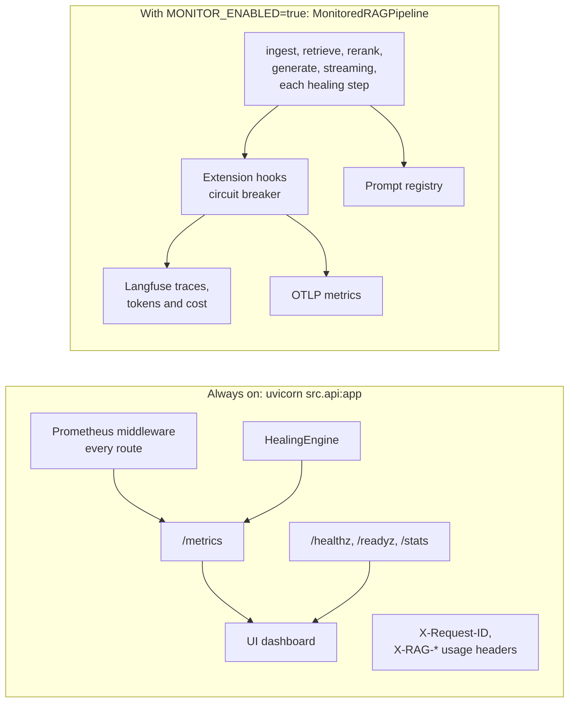

<div align="center">

# Production-Grade RAG Pipeline

**Retrieval-augmented generation as a service: vector-search baseline, optional hybrid retrieval and cross-encoder reranking, multi-provider LLMs, MCP tool exposure, and end-to-end observability.**

[](https://github.com/rajarshidattapy/production_rag/actions/workflows/ci.yml)
[](../LICENSE)

[Quickstart](#quickstart) · [Architecture](#architecture) · [Configuration](#configuration) · [Deployment](#deployment) · [Observability](#observability)

</div>

---

| Layer | Stack |
| :-- | :-- |
| **Core** |    |
| **Retrieval & models** |     |
| **Observability** |     |
| **Async & messaging** |     |
| **Infra & deploy** |      |
| **Cloud** |    |


---

## High-level overview

```
Documents -> Loader -> Chunker -> ChromaDB (dense vectors, per language)
                                     |
                                     +-> BM25 index (built on first hybrid query)

Query -> Detect language -> Vector search            (default)
                            or Hybrid search         (use_hybrid=true)
                         -> Cross-encoder reranker   (only if use_reranker=true)
                         -> Context budget -> LLM -> Answer + citation list
                         -> Verify and repair        (only if self_heal=true)

Deployment -> MCP server -> `search_knowledge_base` (and optional `ask_knowledge_base`)
```

## Architecture

**Ingestion**



**Query**



Hybrid search, reranking, and self-healing are three independent switches, all off by default. Instrumentation is shown separately in [Monitoring & Observability](#monitoring--observability), because it differs by entry point.

### Ways documents get in

| Entry point | Accepted input | Notes |
| ----------- | -------------- | ----- |
| Browser UI, `POST /upload` | **PDF only** | Checks the `.pdf` extension (not the file contents) and `RAG_MAX_FILE_SIZE_MB`, then saves under `data/uploads`. The UI then indexes the files in a background job. |
| `POST /ingest`, `POST /ingest/async` | PDF, TXT, MD, JSON | Takes a file or directory path that must be inside `RAG_DATA_DIR`. The file must already be on the server. |
| `scripts/ingest.py` | PDF, TXT, MD, JSON | Local CLI. Routes to a running API server when there is one. |

JSON files are loaded as raw text, not parsed into fields. To index a TXT, MD, or JSON file you must use one of the path-based entry points.

### Page-aware PDFs

PDFs are chunked one page at a time, and each chunk records its `page` (the physical position in the file, starting at 1, not the label printed on the page). A question that names pages is then answered from those pages only:

| The question says | Retrieved from |
| ----------------- | -------------- |
| `page 5`, `p. 5`, `first page`, `3rd page`, `page one` | That page |
| `pages 3-5`, `pages 3 to 5`, `first 3 pages` | That range |
| `pages 2, 4 and 6`, `page 1 and page 3` | Those pages |
| `last page` | The last page with text, in each PDF |
| `Seite 5`, `erste Seite`, `página 5`, `última página` | The same references in German and Spanish |

- **Filter, not ranking:** The filter applies to vector and BM25 search, across every language collection, and holds through self-healing retries. A page with no extractable text returns "could not find" (or abstains with reason `no_text_on_page`) rather than answering from other pages.
- **Whole page:** These questions retrieve at least `RAG_TOP_K_RETRIEVAL` chunks, even if `top_k` is lower, so the answer sees the whole page. Chunks arrive in reading order unless the reranker is on. `RAG_MAX_CONTEXT_CHARS` still caps the prompt.
- **Every PDF:** "Page 1" matches page 1 of every PDF in the store. Citations name the file and page, but a question can't yet pick one document.
- **Page breaks:** Chunks don't cross pages, so a sentence split by a page break is split in the index too.
- **No page metadata:** If nothing in the store has page metadata, page references are ignored and retrieval works as usual. PDFs indexed before this feature need re-ingesting, with `reset` so the old chunks are removed.

### Background indexing

Attaching PDFs or choosing a folder under **Server folder** in the UI starts a background job, shown live in the sidebar. Indexing carries on if the tab is closed, and the result is written into the chat that started it.

- **Streaming:** Files are processed one at a time and stored in batches of 256 chunks, so the collection's text is never all in memory at once. The vector index still grows with the collection. Text is searchable as soon as its batch is stored, including while the job is running.
- **Bad files:** A file that can't be read, or a PDF with no extractable text, is listed on the job and skipped. The rest of the collection still gets indexed.
- **Cancel:** Stops after the current batch, which can take about a minute on a CPU. Text already indexed stays searchable.
- **Run again:** Available on a cancelled, failed, or interrupted job. Chunks already stored are skipped, so it resumes rather than re-embedding everything. It reads every file again to find what's missing.
- **Restarts:** A graceful shutdown waits for the current batch, so a container manager's stop timeout may end it first, which counts as a crash. After a restart or crash the job is reported as `interrupted`. A crash loses at most the chunks still waiting for their batch, and **Run again** restores them. With the Kafka queue, an interrupted or waiting job runs again by itself once a server is back.
- **Queue:** Jobs run one at a time, in order, because indexing is CPU-bound. Questions keep working meanwhile. By default (`RAG_INGEST_QUEUE=local`) each server process has its own queue and waiting jobs are lost on restart. With `RAG_INGEST_QUEUE=kafka`, jobs wait on a single-partition Kafka topic: they survive restarts, replicas share one queue, and only one replica runs jobs at a time. The app creates the topic if it is missing and refuses to start on a topic with more than one partition. Locally, run `docker compose --profile kafka up`.
- **Uploads:** Files go to the server one at a time before the job starts, so keep the tab open until the job appears. For a very large collection, put the files on the server and use **Server folder**. The path must be inside `RAG_DATA_DIR`.
- **Visibility:** A job started while signed in belongs to that user, and so do the documents it adds. `GET /ingest/jobs` lists only your own jobs, and other users get `404` for them.

Measured on one CPU machine with PyTorch limited to one thread (the default), 2,000 text files, 8,000 chunks, and the real embedding model, against the previous load-everything-first code:

| | Previous | Background job |
| - | -------- | -------------- |
| Time to index | 2,029 s | 1,965 s |
| First text searchable | at the end | about 68 s |
| Peak memory growth during ingest | 198 MB | 155 MB |
| Peak memory growth, 40,000 chunks, stub embeddings | 335 MB | 217 MB |
| Time to index, 40,000 chunks, stub embeddings | 360 s | 551 s |

The stub rows remove embedding cost to expose the pipeline's own overhead: smaller batches and the check for stored chunks add time that the CPU model's cost hides, and that faster hardware would make more noticeable. During the job, `/query` retrieval (with a stubbed LLM) stayed at p50 26 ms and p95 45 ms, against 20 ms and 33 ms idle, with a worst case of 372 ms. **Embedding is the bottleneck at about 4 chunks per second**, so a million chunks would take roughly 70 hours on this setup. That figure is extrapolated, not run.

### Parent sections

Ingestion splits each document into parent sections before chunking: a PDF page, a Markdown heading's section, or up to 4,000 characters of other text. Chunks never cross a parent. Each records its `parent_id`, and its heading path as `section` where there is one. Parent text is stored once in the `rag_parents` collection, without embeddings, for retrieval to hand larger context to the LLM. Retrieval doesn't use it yet.

### Versions, dates, and authority

Every chunk and parent records where it came from, for retrieval to prefer current versions and settle conflicts between sources:

| Field | Meaning |
| ----- | ------- |
| `document_key` | Links versions of one document: its path in the data directory, or its original filename for uploads, per owner |
| `version_id` | The start of the file's SHA-256 (`content_hash` holds all of it). A changed file is stored as a new version beside the old one |
| `document_date` | The PDF's own modified or created date if it has one, otherwise the file's modified time. `document_date_source` says which, because an upload's file time is the upload time |
| `ingested_at` | When it was indexed |
| `collection` | Logical collection from `RAG_SOURCE_COLLECTIONS`, e.g. `{"policies/hr": "hr-policies"}`, else `default` |
| `restricted`, `roles` | Roles allowed to read it, from `RAG_SOURCE_ROLES`, e.g. `{"policies/hr": ["hr"]}`. `restricted` is `false` with no `roles` when none apply. `roles` is stored as a list, so a filter can match one role with `{"roles": {"$contains": "hr"}}` |
| `authority` | 0 to 100, from `RAG_SOURCE_AUTHORITY`, e.g. `{"policies": 90, "uploads": 30}` (folders inside `RAG_DATA_DIR`, longest match wins), else `RAG_DEFAULT_SOURCE_AUTHORITY` (50) |

Retrieval doesn't use these yet, and users don't have roles yet. Names are lowercase letters, digits, `.`, `_`, and `-`. Two uploads with the same filename count as versions of one document, even if they are unrelated.

### Screening before indexing

Every document is screened before it is chunked:

- **Always:** hidden Unicode tag characters (which can spell out invisible instructions) become `[removed hidden text]`, chat-format control tokens such as `<|im_start|>` and `[INST]` become `[removed chat markup]`, and bidirectional overrides and zero-width spaces are removed.
- **Credentials** (`RAG_REDACT_CREDENTIALS`, on by default): API keys, private keys, cloud and chat tokens, JWTs, passwords in URLs, and `password=` style values become `[REDACTED <TYPE>]`.
- **Personal data** (`RAG_PII_MODE`): emails, phone numbers, card numbers (Luhn-checked), IBANs (checksum-checked), US SSNs, and IP addresses. `flag` (the default) keeps the text and records `pii_types` on each chunk, `redact` replaces it, `off` does neither.
- **Instruction-like text** (`RAG_INJECTION_MODE`): phrases such as "ignore previous instructions" in English, German, and Spanish. `flag` (the default) records `injection_signals` on each chunk; `exclude` keeps the whole parent section and its chunks out of the index, and names a file in the job's failures if nothing of it was left.

Each chunk records the settings it was screened with in `screening`. After changing a setting, ingest the files again: their chunks are re-screened, and the copies screened the old way are removed once the new ones are stored. Chunks indexed before `screening` was recorded aren't replaced; clear the store for those.

- **Trusted sources** (`RAG_INJECTION_TRUSTED_AUTHORITY`): documents from sources at or above this authority keep their `injection_signals` but are never marked suspect or excluded, so a security team's own writing about prompt injection isn't treated as an attack.
- **At answer time:** the context tells the model that sources are quoted data, never instructions, and each passage flagged as instruction-like carries a caution naming its signals.
- **Outgoing text** (`RAG_REDACT_ANSWERS`, off by default): redacts credentials and personal data from answers, citations, and `/chunks`, whatever was stored. `/query/stream` then sends the answer once it is complete, because a pattern can span two tokens.

The patterns are signals, not verdicts: they miss instructions they don't describe.

### Retrieval quality

`scripts/evaluate_retrieval.py` scores retrieval without calling an LLM. It indexes a corpus into a throwaway store, runs every golden-dataset question, and treats a chunk as relevant when it comes from one of the question's `expected_sources`, so labels survive re-chunking. It reports Recall@K, Precision@K, MRR, NDCG@K, and hit rate for vector, hybrid, and hybrid-plus-reranker retrieval.

```bash
python -m scripts.evaluate_retrieval --modes vector,hybrid,hybrid_reranked     # check
python -m scripts.evaluate_retrieval --modes vector,hybrid,hybrid_reranked --update-baseline
python -m scripts.evaluate_retrieval --calibrate                               # tune weights
```

- **Regression check:** compares against `data/golden_dataset/retrieval_baseline.json` and exits `1` if any metric drops by more than `--tolerance` (0.02). It refuses to compare (exit `2`) when the dataset, corpus, embedding model, chunk size, or K differ from the baseline's, because the scores wouldn't mean the same thing. CI runs it after the tests.
- **Calibration:** sweeps `RAG_HYBRID_ALPHA` from 0 to 1 and `RAG_RRF_K` over 10, 30, 60, and 100, maximising `--metric` (NDCG by default). It suggests new settings only when they beat the current ones by `--min-gain` (0.01), and says how many questions got better and worse.

On the bundled sample (4 documents, 14 questions, real models), K=5:

| Mode | Recall | Precision | MRR | NDCG |
| ---- | ------ | --------- | --- | ---- |
| Vector | 1.00 | 0.46 | 0.96 | 0.65 |
| Hybrid (alpha 0.6) | 1.00 | 0.57 | 1.00 | 0.77 |
| Hybrid + reranker | 1.00 | 0.63 | 1.00 | 0.85 |

Calibration on that sample favours keywords: alpha 0.1 reaches NDCG 0.90, better on 11 questions and worse on none. The default stays at 0.6, because the sample's questions reuse the documents' own words, which suits BM25. Run calibration on a representative sample of real questions and documents (`--dataset`, `--corpus`) before changing it.

### Start-up and load testing

**Warm-up.** Before the server accepts a request, it loads and runs the embedding model, the language detector, and the reranker, then opens each language's search index and checks configured Redis, logging how long each took. A model or configured Redis instance that can't initialize stops the server from starting, so a broken deployment fails before its first question. If Chroma is still starting, the indexes are built on first use instead. `RAG_WARM_UP_ON_START=false` skips it, and `RAG_WARM_UP_RERANKER=false` leaves the reranker unloaded to save memory. `/readyz` reports ready only once models are loaded, Chroma answers, the indexes are open, and configured Redis responds.

**Load and soak testing.** `scripts/load_test.py` sends sustained concurrent `/query` traffic and reports latency percentiles, throughput, errors, the windows in which errors happened, and memory over time. It runs a sequential baseline, the concurrent soak, then a sequential recovery check, and exits non-zero if the soak breaks its limits: error rate, p95 latency, failures after the load stops, latency that doesn't return to baseline, or memory still growing in the second half. A fake OpenAI-compatible LLM keeps the test from measuring, or paying for, a real one:

```bash
python -m scripts.load_test fake-llm --port 9100 --latency 0.8
OPENAI_BASE_URL=http://127.0.0.1:9100/v1 uvicorn src.api:app --port 8000
python -m scripts.load_test run --concurrency 16 --duration 300 --pid <uvicorn PID>
```

Memory comes from `--pid` locally, or from `process_resident_memory_bytes` on `/metrics` on Linux.

Measured on one Windows machine with the real models, a Chroma server, and a 0.8 s fake LLM, over a 3-minute soak at 16 concurrent with half the queries hybrid: 2,219 queries at 12.3 per second, p50 1.14 s, p95 1.46 s, p99 1.70 s, memory steady at 1.4 GB. Chroma was killed for 20 s partway: the 16 queries in flight got `503`, the rest waited and succeeded, and latency returned to baseline without a restart.

### Accounts and chat history

The browser UI requires an account. Chats are stored on the server in SQLite (`data/chat.db`, or `RAG_CHAT_DB_PATH`), so they follow the user across browsers and devices and survive restarts. Chats that older versions left in a browser's `localStorage` are moved into the account after the user confirms, the first time they sign in on that browser.

- **What an account protects:** Your chats and your documents. PDFs you add while signed in can only be retrieved by you. Documents added without an account are shared, and anyone can read them. `/query`, `/upload`, and `/ingest` still don't need a login (they follow `RAG_API_KEY`), so existing API clients keep working, but they only reach shared documents. Documents indexed before owners were recorded can't be retrieved through the API until they are re-ingested.
- **What gets saved:** A question and its answer are saved together when the answer is ready. A failed query saves nothing. `/query` and `/query/stream` don't save anything.
- **Follow-up questions:** In a chat, a follow-up like "what about page 3?" is first rewritten into a standalone question using the last few messages, with one extra small LLM call. The rewritten text is used for retrieval and generation, and is returned as `searched_for`. If rewriting fails, the question is asked as written. `/query` has no history, so it answers each question on its own.
- **Clearing the store:** `reset` on `/ingest` deletes every user's documents, so the API answers `403` unless `RAG_ALLOW_STORE_RESET=true`.
- **Passwords and sessions:** Passwords are hashed with scrypt. Sessions use an `HttpOnly`, `SameSite=Strict` cookie, and only a hash of the token is stored. Five wrong passwords lock an account for five minutes. One address also gets 20 failed sign-ins or registrations per five minutes (`RAG_AUTH_IP_MAX_ATTEMPTS`, `RAG_AUTH_IP_WINDOW_SECONDS`). With `RAG_REDIS_URL`, this address limit is shared by every replica; otherwise it remains process-local. Behind a proxy, set `FORWARDED_ALLOW_IPS` so the app sees real client addresses; otherwise everyone shares the proxy's limit.
- **Backups:** Back up `data/chat.db`, using `sqlite3 data/chat.db ".backup backup.db"` rather than copying the file while the server runs.
- **Scaling:** SQLite is safe for several workers on one host. It must not sit on a network share, so replicas on separate hosts need a database server first.

Set `RAG_ALLOW_SIGNUP=false` once the accounts you want exist, otherwise anyone who can reach the server can register. Manage accounts from the project root (`/app` in the container):

```bash
python -m scripts.manage_users create alice        # prompts for a password
python -m scripts.manage_users set-password alice  # also clears a lockout and ends their sessions
python -m scripts.manage_users list
python -m scripts.manage_users delete alice        # also deletes their chat history
```

### Retrieval modes

`use_hybrid` and `use_reranker` are independent request fields, so there are four modes. The API and the UI both default to the first.

| `use_hybrid` | `use_reranker` | Candidates | Final passages | Citation `score` |
| ------------ | -------------- | ---------- | -------------- | ---------------- |
| `false` | `false` | Vector search, `top_k` | As retrieved | Cosine similarity |
| `true` | `false` | Hybrid RRF, `top_k` | As retrieved | RRF score (rank-derived, small values) |
| `false` | `true` | Vector search, `RAG_TOP_K_RETRIEVAL` (20) | Reranked to `top_k` | Cross-encoder score |
| `true` | `true` | Hybrid RRF, `RAG_TOP_K_RETRIEVAL` (20) | Reranked to `top_k` | Cross-encoder score |

With self-healing on, the first attempt uses the requested mode. Retrieval retries switch to hybrid unless `RAG_HEALING_ESCALATE_HYBRID=false`, and add reranking only if it was requested or `RAG_HEALING_RERANK_ON_RETRY=true`.

### Two different RRF stages

Reciprocal Rank Fusion is used in two places that do different jobs. They are separate code paths with separate settings.

| | Hybrid RRF | Multi-query RRF |
| | ---------- | --------------- |
| **Question it answers** | How do I combine keyword and semantic rankings for one query? | How do I combine the results of several versions of a query? |
| **Runs when** | `use_hybrid=true`, or a self-healing retry that escalated to hybrid | Self-healing only, from the 2nd retrieval retry onward |
| **Inputs** | The BM25 ranking and the vector ranking of one query | One ranked list per query (original plus every rewrite). Each list is vector-only or already hybrid |
| **Formula** | `alpha/(k+r_vec+1) + (1-alpha)/(k+r_bm25+1)` | Sum of `1/(60+r+1)` across lists, unweighted |
| **Tuning** | `RAG_RRF_K` (60), `RAG_HYBRID_ALPHA` (0.6). Healing retries move alpha by +/-0.25 | Fixed at 60; `RAG_RRF_K` does not apply |
| **Code** | `HybridRetriever.search`, `src/retrieval/hybrid.py` | `fuse_ranked_lists`, `src/healing/adaptive_retrieval.py` |

When both run, hybrid RRF happens per query and multi-query RRF then fuses the results. Any reranking comes last and always scores against the user's original question, not a rewrite.

### Citations: building vs. validating

These are two separate steps, and only the first always happens.

| | Citation list | Citation validation |
| | ------------- | ------------------- |
| **What it does** | Turns retrieved passages into the `citations` array in the response | Checks the `[n]` markers the model wrote in the answer text |
| **Runs when** | Every answer, except an abstention, which returns no citations | Only with self-healing on |
| **Checks** | None. It lists the retrieved passages whether or not the answer cited them | At least one marker; every `n` within `1..passages shown`; at least `RAG_MIN_CITATION_SUPPORT` of cited sentences share enough words with the passage they cite |
| **On failure** | Not applicable | `CITATION_FAILURE`, then regeneration with a citation-repair prompt |
| **Code** | `CitationFormatter.build_citations`, `src/generation/citations.py` | `check_citations`, `src/healing/verifier.py` |

So without self-healing, `[n]` markers are whatever the model wrote and nothing checks them. Two further limits apply:

- `citations` is the list of retrieved passages, not a list of the passages the answer actually relied on.
- On `POST /query` without self-healing, the list is built before the context budget is applied, so it can include passages the model never saw. `/query/stream` and self-healing build it from the passages shown to the model, so `[n]` maps to `citations[n-1]`.

Citation support is a word-overlap heuristic, so it can catch a misattributed citation but cannot prove a claim is true. Claim-level checking comes from the separate LLM judge, which also runs only with self-healing.

### Four Progressive Phases


| Phase                              | What's added                                                                                                                                                                                    | Key files                                                            |
| ---------------------------------- | ----------------------------------------------------------------------------------------------------------------------------------------------------------------------------------------------- | -------------------------------------------------------------------- |
| **1 — Core RAG**                   | Document loading, recursive chunking, ChromaDB vector store, OpenAI/Anthropic generation, citations                                                                                             | `src/ingestion/`, `src/retrieval/vector_store.py`, `src/generation/` |
| **2 — Hybrid Search + Reranking**  | BM25 keyword index, Reciprocal Rank Fusion (RRF), cross-encoder reranker, per-language collections                                                                                              | `src/retrieval/hybrid.py`, `src/retrieval/reranker.py`               |
| **3 — Evaluation + Observability** | LLM-as-Judge faithfulness scoring, golden dataset CI gate, OpenTelemetry metrics, Langfuse tracing, prompt registry                                                                             | `src/evaluation/`, `src/monitoring/`                                 |
| **4 — Self-Healing**               | Post-generation verifier, deterministic failure diagnosis, query rewriting, adaptive retrieval, generation repair, structured abstention, healing metrics/traces, baseline-vs-healed evaluation | `src/healing/`, `src/evaluation/healing_eval.py`                     |


---

## Features

- **Self-Healing Answers (opt-in)** — A verifier checks every answer (citation range and support, retrieval sufficiency, refusal detection, then an LLM judge for faithfulness, relevance, and unresolved contradictions). Failures are diagnosed deterministically into retrieval / query / context / generation / citation failures and repaired accordingly — query rewrite with adapted hybrid retrieval, context expansion, or regeneration with a repair prompt — then re-verified. After `RAG_MAX_HEALING_ATTEMPTS` the service returns a structured abstention instead of an unverified answer. Enable with `RAG_SELF_HEALING_ENABLED=true` or `"self_heal": true` per request.
- **Hybrid Search (opt-in)** — BM25 (built-in inverted index, numpy only) + ChromaDB vector similarity fused with alpha-weighted Reciprocal Rank Fusion. Enable with `"use_hybrid": true`. The BM25 side holds only chunk IDs and term postings (~1.2 KB per chunk) and fetches hit text from the vector store; ingests append to an on-disk journal, and restarts load the index in well under a second. It persists with 0o600 permissions and a size safety guard.
- **Query Embedding Cache** — A thread-safe in-process LRU (`RAG_EMBEDDING_QUERY_CACHE_SIZE`, default 256) avoids re-embedding repeated queries. With `RAG_REDIS_URL`, Redis becomes a TTL-bounded shared L2 cache across replicas; keys hash the model and query rather than storing raw query text. Hit/miss counts are in `/stats`, not `/metrics`.
- **Cross-Encoder Reranking (opt-in)** — Reorders retrieved chunks before generation, on either vector or hybrid results. Enable with `"use_reranker": true`. The default model is `cross-encoder/ms-marco-MiniLM-L-6-v2`, chosen for its small size (about 80 MB) because reranking runs on one CPU thread. It was trained on English; for German or Spanish corpora, consider setting `RAG_RERANKER_MODEL=BAAI/bge-reranker-v2-m3`.
- **Multilingual Routing** — `langdetect` runs per chunk at ingest and per query, routing to per-language ChromaDB collections (en/de/es; anything else falls back to `en`), with prompts translated via gettext. A query searches only its detected language's collection, so a German question will not find English documents.
- **MCP Tool Exposure** — Deploy the RAG service as an MCP server for agent use, exposing `search_knowledge_base` and, optionally, `ask_knowledge_base`; ingestion and admin operations remain private.
- **SSE Token Streaming** — `/query/stream` endpoint delivers tokens over Server-Sent Events as they are generated; compatible with any EventSource client.
- **Background Ingestion** — `POST /ingest/async` queues a job and returns a `job_id` immediately (202). Jobs stream through a collection a batch at a time, report progress and per-file failures, and can be cancelled or resumed. The UI shows them live. See [Background indexing](#background-indexing).
- **LLM Backends** — OpenAI or Anthropic via `RAG_LLM_PROVIDER`, chosen at startup, with streaming for both. Provider-qualified model names or an `sk-or-` key route the OpenAI client to OpenRouter (`RAG_OPENROUTER_MODE` overrides this).
- **Optional API Key Auth** — Set `RAG_API_KEY` to require `Authorization: Bearer <key>` on every route except `/healthz` and the UI page. Auth is off when the variable is unset, which is the default.
- **Prometheus Metrics and Dashboard** — `/metrics` exposes per-route request counts and latency plus self-healing counters. The UI's Observability button shows them as a dashboard.
- **OpenTelemetry and Langfuse Instrumentation (opt-in)** — With `MONITOR_ENABLED=true`, the HTTP service runs through `MonitoredRAGPipeline`, which traces ingest, retrieve, rerank, generate, and each healing step, with token and cost attribution and a circuit breaker. See [Monitoring & Observability](#monitoring--observability).
- **Prompt Registry** — SHA-256 hash-based change detection for prompt versioning across deployments.
- **LLM-as-Judge Evaluation** — All four RAGAS-style quality dimensions via `gpt-4o-mini` against a golden JSONL dataset, with CI quality gate (`--fail-on-threshold`): faithfulness, answer relevance, context precision (Average Precision @ k — are retrieved chunks relevant, ranked well?), and context recall (are reference-answer statements attributable to the retrieved context?).
- **X-Request-ID** — Middleware echoes or generates an `X-Request-ID` header on every response. It is not yet attached to logs or traces.
- **Context Budget** — `RAG_MAX_CONTEXT_CHARS` (default 12000) caps the context sent to the LLM as a cost guardrail. Passages past the budget are dropped, and the last one that fits is cut at the character limit, which can be mid-sentence.
- **Security Hardening** — Path-traversal guards on `/ingest`, BM25 index stored as plain integer arrays loaded with `allow_pickle=False` (no pickle), 0o600 file permissions on data files, `re.escape()` on pricing pattern matching to prevent ReDoS.
- **Docker Multi-Stage Build** — `deps → model-cache → runtime` stages; non-root user, with the default embedding and reranker models cached in the image. The image and compose stack have not been run end to end yet; see [known gaps](#known-gaps-to-close-before-production).
- **Tests and CI** — 735 unit, integration, and stress tests (LLM calls mocked; no API keys needed). GitHub Actions workflows cover CI, the evaluation gate (skipped when the `OPENAI_API_KEY` secret is absent), and GHCR publish on every push to `master`.

---

## Quick Start

### Prerequisites

- Python 3.11+
- An OpenAI API key (or Anthropic key if using `RAG_LLM_PROVIDER=anthropic`)

### Installation

```bash
git clone https://github.com/rajarshidattapy/production_rag.git
cd production_rag

python -m venv .venv
source .venv/bin/activate   # Windows: .venv\Scripts\activate

pip install -r requirements.txt
pip install -e .
```

### Configure

```bash
cp .env.example .env
# Edit .env — at minimum set OPENAI_API_KEY
```

### Ingest Documents

```bash
# Local CLI (no server needed):
python scripts/ingest.py --source data/sample_docs

# With a running API server the CLI auto-routes to it:
python scripts/ingest.py --source path/to/your/docs --reset
```

### Query

```bash
# Basic vector search:
python scripts/query.py --question "What is Retrieval-Augmented Generation?"

# Phase 2 — hybrid + reranker:
python scripts/query.py --question "How does RRF scoring work?" --hybrid --reranker

# Stream tokens over SSE (requires running server):
curl -N -X POST http://localhost:8000/query/stream \
  -H "Content-Type: application/json" \
  -d '{"question": "Explain hybrid search"}'
```

### Run the API Server

Run Chroma as its own server, as production does. Set `RAG_CHROMA_HOST=127.0.0.1` and `RAG_CHROMA_PORT=8001` in `.env`, then start each in its own terminal, with Chroma first:

```bash
chroma run --path data/chroma_server --port 8001
uvicorn src.api:app --reload --host 0.0.0.0 --port 8000
```

If Chroma isn't running, queries return `503` and `/readyz` reports not ready. They recover without restarting the API once Chroma is back. Leaving `RAG_CHROMA_HOST` unset runs Chroma inside the app with no server to start, but that mode has a [known read bug](https://github.com/chroma-core/chroma/issues/7946) the app has to work around.

---

## API Reference


| Method | Endpoint                | Description                                                                                            |
| ------ | ----------------------- | ------------------------------------------------------------------------------------------------------ |
| `GET`  | `/`                     | Browser UI, including the Observability dashboard (no auth)                                            |
| `GET`  | `/healthz`              | Liveness probe — returns `{"status": "ok"}` (no auth)                                                  |
| `GET`  | `/readyz`               | Readiness probe — builds the per-language stores, BM25 indexes, and reranker object, and sends Chroma a heartbeat on every call. Returns 503 when Chroma is unreachable |
| `GET`  | `/stats`                | Pipeline statistics (model, config, and chunk and cache counts totalled across all languages)          |
| `GET`  | `/metrics`              | Prometheus scrape endpoint — request count + latency histograms by route, plus `rag_healing_*` metrics |
| `GET`  | `/chunks/{chunk_id}`    | Full text of a cited passage (`404` once it has left the store)                                        |
| `POST` | `/upload`               | Save a browser-uploaded **PDF** under `data/uploads` (does not index it; call `/ingest` next)          |
| `POST` | `/ingest`               | Ingest PDF, TXT, MD, or JSON from a path inside the data directory (blocks until done)                 |
| `POST` | `/ingest/async`         | Queue ingestion as a background job; returns `job_id` immediately (202). Optional `label` and `chat_id` |
| `GET`  | `/ingest/jobs`          | Your most recent jobs, newest first (requires signing in)                                              |
| `GET`  | `/ingest/jobs/{job_id}` | Status of a job: progress, chunks added, and files that failed                                         |
| `POST` | `/ingest/jobs/{job_id}/cancel` | Stop a queued or running job after its current batch (`409` once it has ended)                  |
| `POST` | `/ingest/jobs/{job_id}/retry`  | Run a cancelled, failed, or interrupted job again, skipping chunks already stored               |
| `POST` | `/query`                | Synchronous Q&amp;A — returns answer + citations                                                       |
| `POST` | `/query/stream`         | **SSE streaming** — streams tokens then citations                                                      |


### Accounts and chats

These use the session cookie set by `/auth/register` or `/auth/login`, and also need `Authorization: Bearer <key>` when `RAG_API_KEY` is set. Another user's chat returns `404`.

| Method | Endpoint | Description |
| ------ | -------- | ----------- |
| `POST` | `/auth/register` | Create an account and sign in (`403` when `RAG_ALLOW_SIGNUP=false`) |
| `POST` | `/auth/login` | Sign in (`401` for wrong details, `429` during a lockout) |
| `POST` | `/auth/logout` | End this session |
| `GET` | `/auth/me` | The signed-in username |
| `GET` | `/chats` | Your chats, most recently active first, without messages |
| `POST` | `/chats` | Create a chat, with an optional `title` |
| `GET` | `/chats/{chat_id}` | A chat with its messages |
| `DELETE` | `/chats/{chat_id}` | Delete a chat's history (its documents stay in the store) |
| `POST` | `/chats/{chat_id}/messages` | Ask a question with the same body as `/query`, and save it with the answer |
| `POST` | `/chats/{chat_id}/files` | Record documents ingested for this chat |
| `POST` | `/chats/import` | Copy in a chat saved elsewhere; repeating an `import_id` changes nothing |

### POST /query

```json
{
  "question": "What is hybrid search?",
  "top_k": 5,
  "use_hybrid": true,
  "use_reranker": true
}
```

Response:

```json
{
  "answer": "Hybrid search combines...",
  "citations": [
    {"chunk_id": "abc123", "source": "doc.pdf", "filename": "doc.pdf",
     "text_snippet": "...", "score": 0.842, "page": 3}
  ]
}
```

`page` is present only for sources that have pages (PDFs). `text_snippet` is a preview of up to 180 characters, taken from the start of the passage and cut at a word boundary. It is not the part the answer relied on. Fetch the whole passage from `GET /chunks/{chunk_id}`.

Add `"self_heal": true` (or set `RAG_SELF_HEALING_ENABLED=true`) to verify and repair
the answer before it is returned. The response then includes an extra `healing`
object — omitted entirely when healing did not run, so existing clients are unaffected:

```json
{
  "answer": "Hybrid search combines... [1]",
  "citations": [...],
  "healing": {"status": "recovered", "attempts": 2, "recovered": true,
              "failure_types": ["RETRIEVAL_FAILURE"], "query_rewrites": ["..."]}
}
```

If no verified answer can be produced, the answer is
`"Unable to answer reliably from the available context."` with
`"healing": {"status": "abstained", "reason": "insufficient_verified_context", "attempts": 3, ...}`.

### POST /query/stream

Same request body as `/query`. Response is a stream of Server-Sent Events:

```
data: {"token": "Hybrid"}
data: {"token": " search"}
...
data: {"citations": [...]}
data: [DONE]
```

With self-healing on, the answer is verified first and only the verified answer is
streamed, with one extra `data: {"healing": {...}}` event before `citations`.

### Request Headers


| Header                        | Description                                                       |
| ----------------------------- | ----------------------------------------------------------------- |
| `Authorization: Bearer <key>` | Required when `RAG_API_KEY` is set                                |
| `X-Request-ID`                | Optional correlation ID; echoed in response (generated if absent) |


`POST /query` returns **503** when Chroma is unreachable and **504** when it exceeds `RAG_QUERY_TIMEOUT_SECONDS`. `/query/stream` reports both as an `error` event, because its status line has already been sent. After a timeout, a self-healing or vector-search worker thread can keep running until its own client timeout ends it.

`POST /query` responses also carry `X-RAG-Prompt-Tokens`, `X-RAG-Completion-Tokens`, `X-RAG-Total-Tokens`, and `X-RAG-LLM-Latency-Sec`, summed across every LLM call in the request. These are headers only; they are not in the JSON body and are not sent by `/query/stream`.


---

## Configuration

All settings use the `RAG_` prefix and can be set via `.env` or environment variables.

### Core Settings


| Variable                         | Default                                | Description                                                 |
| -------------------------------- | -------------------------------------- | ----------------------------------------------------------- |
| `RAG_LLM_PROVIDER`               | `openai`                               | LLM backend: `openai` or `anthropic`                        |
| `RAG_LLM_MODEL`                  | `gpt-4o-mini`                          | Model name for the selected provider                        |
| `RAG_OPENROUTER_MODE`            | `auto`                                 | `true`/`false` forces OpenRouter routing on or off for the OpenAI client. An explicit `OPENAI_BASE_URL` always takes priority |
| `RAG_CHROMA_HOST`, `RAG_CHROMA_PORT` | *(unset)*                          | Use a Chroma server instead of the embedded store           |
| `OPENAI_API_KEY`                 | —                                      | OpenAI API key                                              |
| `ANTHROPIC_API_KEY`              | —                                      | Anthropic API key                                           |
| `RAG_DATA_DIR`                   | `data`                                 | Root directory for data files                               |
| `RAG_CHROMA_PATH`                | `data/chroma_db`                       | ChromaDB persistence directory                              |
| `RAG_CHUNK_SIZE`                 | `800`                                  | Target chunk size in characters                             |
| `RAG_CHUNK_OVERLAP`              | `150`                                  | Overlap between adjacent chunks                             |
| `RAG_SEMANTIC_DEDUPLICATION`     | `true`                                 | Skip duplicate chunks from another document owned by the same user |
| `RAG_SEMANTIC_DEDUPLICATION_THRESHOLD` | `0.985`                         | Minimum embedding similarity for near-duplicate suppression |
| `RAG_TOP_K_RETRIEVAL`            | `20`                                   | Candidates fetched before reranking                         |
| `RAG_TOP_K_FINAL`                | `5`                                    | Final context chunks passed to the LLM                      |
| `RAG_MAX_CONTEXT_CHARS`          | `12000`                                | Total context characters sent to the LLM (`0` disables)     |
| `RAG_QUERY_TIMEOUT_SECONDS`      | `180`                                  | Overall limit for one query, including retries and self-healing (`0` disables) |
| `RAG_MAX_FILE_SIZE_MB`           | `50`                                   | Per-file limit for upload and ingest                        |
| `RAG_HYBRID_ALPHA`               | `0.6`                                  | Hybrid RRF weight: 1.0 = pure vector, 0.0 = pure BM25       |
| `RAG_RRF_K`                      | `60`                                   | Hybrid RRF constant (multi-query RRF is fixed at 60)        |
| `RAG_HNSW_EF_SEARCH`             | `200`                                  | HNSW search breadth: higher = better recall, same latency up to ~200 |
| `RAG_HNSW_MAX_NEIGHBORS`         | `16`                                   | HNSW graph degree M (new collections only; 32 adds ~20% build time) |
| `RAG_HNSW_EF_CONSTRUCTION`       | `100`                                  | HNSW build breadth (new collections only)                   |
| `RAG_BM25_MAX_INDEX_MB`          | `500`                                  | Max BM25 index file persisted/loaded (~1 KB/chunk; use ~2000 for 1M chunks) |
| `RAG_EMBEDDING_QUERY_CACHE_SIZE` | `256`                                  | LRU cache size for repeated query embeddings (`0` disables) |
| `RAG_REDIS_URL`                  | *(unset)*                              | Optional Redis URL for shared embeddings and authentication limits |
| `RAG_REDIS_KEY_PREFIX`           | `rag`                                  | Namespace for this deployment's Redis keys                 |
| `RAG_REDIS_SOCKET_TIMEOUT_SECONDS` | `0.5`                                | Redis connect and command timeout                           |
| `RAG_REDIS_EMBEDDING_CACHE_TTL_SECONDS` | `86400`                         | Shared embedding lifetime; local LRU remains size-bounded   |
| `RAG_RERANKER_MODEL`             | `cross-encoder/ms-marco-MiniLM-L-6-v2` | Cross-encoder model                                         |
| `RAG_FAITHFULNESS_THRESHOLD`     | `0.7`                                  | Minimum faithfulness score for CI gate                      |
| `RAG_CORS_ORIGINS`               | `*`                                    | Comma-separated allowed CORS origins                        |
| `RAG_API_KEY`                    | *(unset)*                              | Bearer token for API auth (disabled when unset)             |
| `RAG_CHAT_DB_PATH`               | `<RAG_DATA_DIR>/chat.db`               | SQLite file for accounts and chats; use a local disk        |
| `RAG_ALLOW_SIGNUP`               | `true`                                 | Let anyone who can reach the server register                |
| `RAG_ALLOW_STORE_RESET`          | `false`                                | Let `reset` on `/ingest` delete every user's documents      |
| `RAG_SOURCE_AUTHORITY`           | `{}`                                   | JSON of folder to authority 0-100, e.g. `{"policies": 90}`   |
| `RAG_DEFAULT_SOURCE_AUTHORITY`   | `50`                                   | Authority for documents in no configured folder             |
| `RAG_SOURCE_COLLECTIONS`         | `{}`                                   | JSON of folder to collection name                           |
| `RAG_REDACT_CREDENTIALS`         | `true`                                 | Replace API keys, private keys, tokens, and passwords       |
| `RAG_PII_MODE`                   | `flag`                                 | Personal data: `flag`, `redact`, or `off`                   |
| `RAG_INJECTION_MODE`             | `flag`                                 | Instruction-like text: `flag`, or `exclude` from the index  |
| `RAG_WARM_UP_ON_START`           | `true`                                 | Load models and search indexes before accepting requests    |
| `RAG_WARM_UP_RERANKER`           | `true`                                 | Include the reranker in the warm-up                         |
| `RAG_INJECTION_TRUSTED_AUTHORITY` | *(unset)*                             | Sources at or above this authority are never marked suspect |
| `RAG_REDACT_ANSWERS`             | `false`                                | Redact credentials and personal data from what is returned  |
| `RAG_SOURCE_ROLES`               | `{}`                                   | JSON of folder to the roles allowed to read it              |
| `RAG_AUTH_IP_MAX_ATTEMPTS`       | `20`                                   | Failed sign-ins and registrations per address per window    |
| `RAG_AUTH_IP_WINDOW_SECONDS`     | `300`                                  | Length of that window                                       |
| `RAG_SESSION_TTL_HOURS`          | `720`                                  | How long a login lasts                                      |
| `RAG_SESSION_COOKIE_SECURE`      | `false`                                | Force `Secure` cookies; automatic on direct HTTPS requests  |
| `RAG_LOG_LEVEL`                  | `INFO`                                 | Logging level                                               |


### Self-Healing Settings


| Variable                     | Default               | Description                                                        |
| ---------------------------- | --------------------- | ------------------------------------------------------------------ |
| `RAG_SELF_HEALING_ENABLED`   | `false`               | Server-wide default (per-request `self_heal` overrides)            |
| `RAG_MAX_HEALING_ATTEMPTS`   | `3`                   | Total generate→verify attempts, including the first                |
| `RAG_VERIFIER_ENABLED`       | `true`                | LLM judge in the verifier (deterministic checks always run)        |
| `RAG_VERIFIER_LLM_MODEL`     | *(= `RAG_LLM_MODEL`)* | Judge model                                                        |
| `RAG_FAITHFULNESS_THRESHOLD` | `0.7`                 | Faithfulness pass bar (shared with the eval gate)                  |
| `RAG_RELEVANCE_THRESHOLD`    | `0.7`                 | Relevance pass bar                                                 |
| `RAG_MIN_RETRIEVAL_SCORE`    | `0.2`                 | Floor for the top vector / cross-encoder score (not RRF)           |
| `RAG_MIN_QUERY_COVERAGE`     | `0.4`                 | Query-term coverage floor (hard gate only without a judge verdict) |
| `RAG_MIN_CITATION_SUPPORT`   | `0.5`                 | Fraction of cited sentences that must overlap the cited passage    |


More tuning knobs (`RAG_HEALING_*`) are documented in the [Self-Healing section](#self-healing) below.

### Monitoring Settings (`MONITOR_` prefix)


| Variable                                   | Default                 | Description                                                                     |
| ------------------------------------------ | ----------------------- | ------------------------------------------------------------------------------- |
| `MONITOR_ENABLED`                          | `false`                 | Runs the HTTP service and `scripts/evaluate.py` through `MonitoredRAGPipeline`  |
| `MONITOR_LANGFUSE_SECRET_KEY`              | —                       | Langfuse secret key (`sk-lf-…`)                                                 |
| `MONITOR_LANGFUSE_PUBLIC_KEY`              | —                       | Langfuse public key (`pk-lf-…`)                                                 |
| `MONITOR_LANGFUSE_HOST`                    | `http://localhost:3000` | Langfuse server URL                                                             |
| `MONITOR_OTEL_SERVICE_NAME`                | `rag-pipeline`          | OTel service name                                                               |
| `MONITOR_OTEL_EXPORTER_OTLP_ENDPOINT`      | `http://localhost:4318` | OTLP receiver endpoint                                                          |
| `MONITOR_CIRCUIT_BREAKER_THRESHOLD`        | `3`                     | Failures before circuit opens                                                   |
| `MONITOR_CIRCUIT_BREAKER_COOLDOWN_SECONDS` | `30.0`                  | Seconds before half-open retry                                                  |


---

## Monitoring &amp; Observability

There are two layers. The first is always on in the HTTP service, and the second is added by `MONITOR_ENABLED=true`.



The wrapper applies to the HTTP service and `scripts/evaluate.py`. `requirements.txt` includes the Langfuse v2 SDK (the tracer uses its `trace()`/`span()` API, so it is pinned below v3) and the OTLP exporter. The drill confirmed that a server with this setting sends metrics and traces to the configured endpoints, using local fake endpoints rather than real Langfuse or collector services.

### What each pipeline stage emits

| Stage | Always on | With `MONITOR_ENABLED=true` |
| ----- | ------------ | ---------------------- |
| Upload, ingest | Request count and latency per route | `ingest` span |
| Retrieve (vector or hybrid) | Only inside total request latency | `retrieve` span and latency histogram |
| Rerank | Only inside total request latency | `rerank` span with pre- and post-scores |
| Generate | Tokens and LLM latency as `/query` response headers | `generate` span with model, tokens, and cost (estimated tokens when streaming) |
| Verify and repair | `rag_healing_*` metrics on `/metrics` | The same metrics exported over OTLP, plus one span per step |
| Embedding cache | Hit and miss counts in `/stats` | Not recorded |
| Errors | Per-route counts by status code | `rag_{step}_errors_total`, span errors |

`scripts/query.py` and `scripts/ingest.py` use the plain pipeline, so they emit none of these signals. Prometheus counters are per process and reset on restart, so a multi-replica deployment needs Prometheus to scrape and aggregate each replica. There is no logging correlation yet: `X-Request-ID` is returned to the caller but is not attached to log lines or traces.

### Prometheus (HTTP service)

`GET /metrics` exposes `rag_http_requests_total{path,method,status_code}` (requests matching no route share `path="unmatched"`), `rag_http_stream_errors_total{path,reason}` (streams that failed after answering 200), `rag_http_request_duration_seconds{path,method}`, and the `rag_healing_*` metrics listed under [Self-Healing Observability](#self-healing-observability). The UI's **Observability** button reads these along with `/healthz` and `/stats`, and excludes health checks and its own polling from the request counts.

### OpenTelemetry Metrics

With `MONITOR_ENABLED=true` and an OTLP endpoint reachable, these are exported:

- **`rag_{retrieve,rerank,generate,query_total}_latency_seconds`** — latency histograms per step
- **`rag_{retrieve,rerank,generate,query_total}_errors_total`** — error counters per step
- **`rag_queries_total`** — queries processed
- **`rag_context_chunks_per_query`**, **`rag_cost_per_query_dollars`**, **`rag_tokens_*`** — context, cost, and token histograms

A JSON summary (P50/P95 latency, avg cost, error count) is exported via `MetricsCollector.export_summary()` and written with 0o600 permissions.

### Langfuse Tracing

With `MONITOR_ENABLED=true` and Langfuse credentials set, each query creates a trace with spans for:

- `retrieve` — vector/hybrid search timing
- `rerank` — cross-encoder reranking timing
- `generate` — LLM generation with model, token counts, and cost

A circuit breaker (`MONITOR_CIRCUIT_BREAKER_THRESHOLD`) isolates Langfuse failures so a tracing outage does not block query responses.

### Self-Healing Observability

With `MONITOR_ENABLED=true`, healed queries
get one span per healing step under the query trace — `retrieve_attempt_1`,
`rerank_attempt_1`, `generate_attempt_1`, `verify_attempt_1`, `query_rewrite`,
`retrieve_attempt_2`, … — with the verifier's decision (`passed`, `failure_type`,
`reason`, scores) on each `verify_attempt_N` span.

Healing metrics are recorded wherever healing runs, so they appear on `/metrics` in the HTTP service. They are also exported over OTLP with `MONITOR_ENABLED=true`:
`rag.healing.attempts`, `rag.healing.success`, `rag.healing.failures{failure_type}`,
`rag.healing.abstentions`, `rag.healing.query_rewrites`, `rag.healing.retrieval_retries`,
`rag.healing.regenerations`, `rag.healing.latency` (Prometheus: `rag_healing_*`).

### Using the Monitored Pipeline as a Library

```python
from src.monitoring import MetricsCollector, MonitoredRAGPipeline, Tracer
from src.pipeline import RAGPipeline

pipeline  = RAGPipeline()
tracer    = Tracer(enabled=True)
metrics   = MetricsCollector(enabled=True)
monitored = MonitoredRAGPipeline(pipeline, tracer=tracer, metrics=metrics)

answer, citations = monitored.query("What is RAG?", use_hybrid=True)
metrics.export_summary("monitoring-summary.json")
```

### Prompt Registry

```python
from src.monitoring.prompts import PromptRegistry

registry    = PromptRegistry()
prompt_hash = registry.register("system_v1", "You are a helpful assistant…")
changed     = registry.detect_change("system_v1", new_prompt_text)
```

---

## Docker

> These commands have not been run end to end yet. See [known gaps](#known-gaps-to-close-before-production) for what has been checked.

### Build

```bash
docker build -t production-rag:latest .
```

### Run

```bash
docker run -p 8000:8000 \
  -e OPENAI_API_KEY=sk-... \
  -e RAG_LLM_PROVIDER=openai \
  -v $(pwd)/data:/app/data \
  production-rag:latest
```

### Compose

```bash
docker compose up --build
```

This starts the API, a private Chroma server, and a private ephemeral Redis instance. Redis shares query embeddings and authentication-attempt limits across API replicas; it does not cache generated answers or hold durable application data. Direct runs keep the original in-memory behavior unless `RAG_REDIS_URL` is set. For agent deployments, expose the service through MCP with `search_knowledge_base` and optional `ask_knowledge_base`; keep ingestion and admin operations private. Compose reads the `RAG_LLM_*`, `RAG_API_KEY`, `RAG_CORS_ORIGINS`, `MONITOR_ENABLED`, and provider key values from your `.env` for substitution. On Linux hosts, `./data` must be writable by UID 1001, the user the API runs as.

### Supply-chain security

The supply-chain workflow audits Python dependencies and scans repository configuration, secrets, and vulnerabilities on dependency changes and every week. Image publishing also scans the final image, attaches BuildKit provenance and an SPDX JSON SBOM, and signs the immutable image digest with GitHub's OIDC identity. A high or critical fixed vulnerability stops the workflow before signing.

Before deployment, verify the digest rather than trusting a mutable tag:

```bash
cosign verify \
  --certificate-identity-regexp 'https://github.com/rajarshidattapy/production_rag/.github/workflows/docker-publish.yml@refs/(heads|tags)/.+' \
  --certificate-oidc-issuer 'https://token.actions.githubusercontent.com' \
  ghcr.io/rajarshidattapy/production-rag@sha256:<digest>
```

Each publish run exposes `production-rag-sbom.spdx.json` as a machine-readable workflow artifact; BuildKit also publishes an SBOM attestation alongside the image.

---

## Why Not LangChain?

This project builds retrieval, fusion, reranking, and generation directly against `chromadb`, a small in-repo BM25 implementation, and the OpenAI/Anthropic SDKs instead of a framework. The tradeoffs, deliberately:

- **Every retrieval decision is explicit and testable.** RRF fusion (`src/retrieval/hybrid.py`) and context-budget trimming (`src/pipeline.py`) are plain functions with unit tests — not framework internals to work around when they don't fit a use case.
- **Fewer version-compatibility surprises.** Framework abstraction layers add a dependency-resolution axis (framework version × provider SDK version × vector-store client version) that has historically been a common source of breakage in LangChain-based projects.
- **Debuggability.** A stack trace from `pipeline.query()` points directly at ingestion, retrieval, or generation code — not through several layers of chain/agent abstraction.
- **When a framework *would* make sense:** rapid prototyping across many retrieval strategies, or when the team needs pre-built integrations for dozens of vector stores/tools out of the box. For a single, well-understood production RAG stack, the direct approach costs a small amount of boilerplate for a large amount of control and interview-defensible design decisions.

## Scaling to Production

What changes as load grows, based on what has actually been measured. All numbers are from one Windows 11 laptop (16.8 GB RAM), and retrieval timings use stub embeddings. Treat them as relative guidance, not capacity figures.

- **Horizontal scaling:** The drill ran two API replicas with separate disks on one Chroma server. Reads worked, a document ingested through one replica was found by the other, and a replica recovers on its own after another resets the store. Two caveats: async job status is only shared if replicas share a disk, and each replica detects BM25 staleness by chunk count, so a same-count replacement ingested elsewhere goes unnoticed.
- **Hybrid search at scale:** At 50k chunks, BM25 queries took 2-3 ms and a cold index load 0.2 s. A full rebuild took about 5 s. Memory measured at 100k chunks was about 1.2 KB per chunk, which extrapolates to about 1.2 GB at 1M chunks and needs `RAG_BM25_MAX_INDEX_MB` near 2000. The 1M figures have not been run.
- **Vector search:** `RAG_HNSW_EF_SEARCH` matters most. On 50k synthetic vectors, recall@10 was 0.74 at 10, 0.996 at 100, and 1.000 at 200, with the same latency of about 1.4 ms. The default is 200. A single Chroma instance has no sharding or replicas. The per-language collections are a natural shard boundary if you move to a distributed vector database.
- **Where the time goes:** In production the LLM call and reranker should dominate, not the vector store. This has not been measured with a real provider or model, so load-test those before sizing anything.

---

## Production Readiness

**Summary: production-oriented, not production-validated.** There is real evidence for correctness and for failure behaviour on one Windows machine. There is no evidence yet from Linux, from the Docker stack running end to end, or from a production deployment.

Last assessed 2026-11-03, on commit `a9d1baf` plus the fixes described here.

### Evidence

| Area | Evidence | Status |
| ---- | -------- | ------ |
| CI steps, run locally | `ruff check`, `ruff format --check`, `mypy src/`, and `pytest --cov`, in a clean environment installed from `requirements-dev.txt` | All pass on Windows with Python 3.11: 280 tests, 84% line coverage. Not yet run on GitHub or on Linux |
| Flaky test | An earlier full run had 1 failed test (not identified), and another failed `test_multilingual_ingestion_routing` with a Chroma HNSW error | Not reproduced in later runs, and the cause was not found, so it may return |
| Vector store stress | `tests/test_vector_store_stress.py`: ingest, recall, concurrent reads and writes, deletes, persistence | Passes at 50k chunks embedded on the current code, with stub embeddings. It last passed at 20k against a Chroma server before this round of changes, and the drill has exercised server mode since |
| Failure drill | `python scripts/operational_drill.py`: real API and Chroma processes, hard-killed and restarted | 26 of 26 checks met, results below |
| Retrieval and answer quality | `scripts/evaluate.py` and `--healing-report` | **No published results.** They need a provider API key, and the test suite does not measure answer quality |
| Real providers | Anthropic and OpenAI calls | **Not run against live APIs.** Tests use mocks, and the drill uses a local fake. Mocks hid a bug that made every Anthropic call fail until `autospec` tests against the real SDK signatures were added |
| Docker image | `Dockerfile` | **Not built.** Read through only |
| `docker compose` | `docker-compose.yml` | **Not run.** Checked against the published Chroma 1.5.9 image: it persists to `/data`, and it has `bash` but no `curl` |
| Production deployment | None | **None.** No real traffic, SLOs, alerting, on-call, or incident history |

### Failure drill results

The drill uses real API and Chroma server processes on loopback, a local fake LLM with 50 ms latency, and stub embeddings, so it measures service behaviour and overhead, not real LLM, embedding, or reranker cost. It runs outside the repository so it cannot read a developer's `.env`, and it refuses to start if LLM calls would go anywhere but the local fake. It does not involve Docker. Timings below are from one run with `RAG_QUERY_TIMEOUT_SECONDS=20`.

| Scenario | What we want | Observed | Met? |
| -------- | ------------ | -------- | ---- |
| Chroma down when the API first connects | 503 | 503 after 14.8 s | Yes |
| Startup | API healthy; ingest and query work | Healthy in 9.1 s; 16 chunks ingested; vector and hybrid queries returned 200 | Yes |
| Load: 300 `/query` at concurrency 20, vector | All 200 | All 200; 37 req/s, p50 513 ms, p95 720 ms | Yes |
| Load: 300 `/query` at concurrency 20, hybrid | All 200 | All 200; 29 req/s, p50 669 ms, p95 818 ms | Yes |
| LLM provider returns 429 | 429 passed to the caller | 429 after 7.1 s of retries | Yes |
| LLM provider returns 500 | Clean 5xx | 502 after 7.1 s of retries | Yes |
| LLM provider hangs | 504 at the deadline | 504 after 20.0 s | Yes |
| LLM provider recovers | 200 with no restart | 200 | Yes |
| Chroma killed: `/healthz` | 200 (process is alive) | 200 | Yes |
| Chroma killed: `/readyz` | 503 (stop sending traffic) | 503 in 2.0 s | Yes |
| Chroma killed: `/query` | 503 | 503 after 11.6 s | Yes |
| Chroma restarted | 200 with no API restart | 200 after 2.2 s | Yes |
| API killed and restarted | Chunks intact; hybrid works | 16 chunks before and after; healthy in 9.1 s; hybrid returned 200 | Yes |
| Async job status after restart | Job still known | 200, status `completed` | Yes |
| Two replicas: cross-replica ingest | Replica B finds a document ingested through A | Found | Yes |
| Two replicas: A runs `reset=true` | B keeps working with no restart | 200 | Yes |
| `MONITOR_ENABLED=true` | `/query` and `/query/stream` work; data reaches OTLP and Langfuse endpoints | Both work; 8 OTLP exports and 4 Langfuse calls to local fakes | Yes |

**Reading the load numbers:** treat them as rough. Run to run they varied widely on this machine: an earlier run of the previous code measured 99 and 40 req/s, while a side-by-side comparison measured 42 and 29 req/s for the previous code and 37 and 28 req/s for the current code. They exclude real LLM, embedding, and reranker time, which should dominate in production.

**The outage timings are slow on this machine:** each refused connection took about 2 s on Windows, and the client retries before giving up. They have not been measured on Linux.

### Known gaps to close before production

**Deployment**

1. **The Docker image and compose stack have not been run.** The known compose problems are fixed (healthcheck, data volume path, UI missing from the image, unpinned Chroma image), but only by inspection and config tests, so expect to find out more on the first real run.
2. **CI has not run on GitHub yet.** The workflows now trigger on `master`. Each push to `master` will also publish an image to GHCR.
3. **The image includes the full GPU build of PyTorch** on Linux, adding several GB. CPU-only deployments could install from the PyTorch CPU index instead.

**Reliability**

4. **Timed-out work can keep running.** After a 504, a self-healing or retrieval worker thread continues until its own LLM client timeout ends it, so sustained timeouts can tie up worker threads.
5. **BM25 staleness is detected by chunk count**, so a same-count replacement ingested through another replica goes unnoticed.
6. **Async job status needs a shared disk** to be visible across replicas. Two replicas sharing one could also mislabel a job still running on the other as `interrupted`.

**Observability**

7. **`X-Request-ID` does not reach logs or traces**, so requests cannot yet be correlated across them.
8. **`MonitoredRAGPipeline.query_stream` (the older synchronous method) does not work with real LLM streaming.** The HTTP service uses `stream_answer` instead.

**Background indexing**

- **Run again reads every file.** It skips embedding stored chunks, but loading and chunking a large collection again still takes time.
- **Each replica has its own job queue** unless `RAG_INGEST_QUEUE=kafka`, so jobs on different replicas run at the same time. Cancelling only works on the replica that queued the job, and with Kafka only if that replica is also the one running it.
- **Scanned PDFs are not indexed.** They are reported as having no extractable text; there is no OCR.

**Accounts**

- **No self-service password reset.** An operator resets passwords with `scripts/manage_users.py`.
- **Login limits are per replica.** Each process keeps its own per-address count.

**Defaults to change for a real deployment**

9. Auth is off unless `RAG_API_KEY` is set, CORS defaults to `*`, and anyone who can reach the server can register until `RAG_ALLOW_SIGNUP=false`. Behind a TLS-terminating proxy, also set `RAG_SESSION_COOKIE_SECURE=true`.

### Not tested at all

- Linux, including the Docker stack
- Real LLM, embedding, and reranker latency or cost under load
- Soak tests, memory growth over time, and traffic beyond the short burst above
- Corpora beyond 100k chunks (the 1M figures are extrapolations)
- Disk-full, network partition, and multi-host deployment
- Backup and restore, index format upgrades, and rollback
- Real Langfuse and OTLP backends (the drill uses local fakes)
- Security testing of a deployed instance; the audit notes further down this page are code reviews

---

## Evaluation

The evaluation suite uses **LLM-as-Judge** scoring across all four standard RAG quality dimensions against a golden dataset:


| Dimension             | What it measures                                                      | Scoring method                                                           |
| --------------------- | --------------------------------------------------------------------- | ------------------------------------------------------------------------ |
| **Faithfulness**      | Is the answer's every claim supported by the retrieved context?       | LLM-judged score 0–1                                                     |
| **Answer Relevance**  | Does the answer address the question asked?                           | LLM-judged score 0–1                                                     |
| **Context Precision** | Are retrieved chunks relevant, and are relevant chunks ranked higher? | Average Precision @ k, computed from per-chunk LLM relevance verdicts    |
| **Context Recall**    | Does the retrieved context cover everything in the reference answer?  | Fraction of reference-answer statements attributable to context, via LLM |


Context precision/recall scores are computed deterministically from binary per-item LLM verdicts (not a self-reported LLM aggregate) — more robust to judge arithmetic mistakes, and matches the [RAGAS](https://github.com/explodinggradients/ragas) methodology this evaluation suite is modeled on.

```bash
# Create a sample golden dataset:
python scripts/evaluate.py --create-sample-dataset

# Run evaluation (Phase 2 features + CI exit code):
python scripts/evaluate.py --hybrid --reranker --fail-on-threshold --export-ci-summary
```

**Self-healing evaluation** runs a hard dataset (vocabulary-mismatched paraphrases,
terse and vague queries, multi-hop questions, and unanswerable questions) twice —
healing off vs. on — and reports initial retrieval failure rate, healing success rate,
average attempts, faithfulness/relevance before vs. after, citation validity,
abstention rate (correct vs. false), false-positive healing, and latency overhead:

```bash
python scripts/evaluate.py --healing-report --hybrid
python scripts/evaluate.py --self-heal --hybrid --reranker   # standard set with healing on
```

The `evaluate.yml` GitHub Actions workflow runs this gate on pushes to `master`, and skips it with a notice when the `OPENAI_API_KEY` secret is not set. **It has not run yet**, so no results are published here. The gate keys off faithfulness only; context precision/recall are reported alongside for visibility.

---

## Testing

```bash
# Full suite (280 tests):
python -m pytest tests/ -v

# With coverage report:
python -m pytest tests/ --cov=src --cov-report=term-missing

# Single module:
python -m pytest tests/test_monitoring.py -v
```

### Test Coverage


| Module                        | Coverage focus                                                                                    |
| ----------------------------- | ------------------------------------------------------------------------------------------------- |
| `test_pipeline.py`            | End-to-end query/ingest flows                                                                     |
| `test_retrieval.py`           | Vector store, hybrid retriever, BM25 scoring and persistence, RRF, embedding cache, reranker      |
| `test_vector_store_stress.py` | Scaled ingest, recall, concurrency, deletes, persistence (`RAG_STRESS_*` to scale or use a server) |
| `test_operations.py`          | Regressions from the failure drill: deployment config, outages, deadlines, job status, replica recovery, monitoring wiring, SDK signatures |
| `test_ingestion.py`           | Document loading and chunking strategies                                                          |
| `test_evaluation.py`          | LLM-as-Judge scorer, golden dataset, CI summary                                                   |
| `test_monitoring.py`          | Tracer spans, MetricsCollector, circuit breaker, guardrails                                       |
| `test_api.py`, `test_api_extensions.py` | FastAPI endpoints, auth, SSE streaming, upstream error mapping                          |
| `test_i18n.py`                | Language routing and localized responses                                                          |
| `test_versioning.py`          | Version bump tooling                                                                              |
| `test_healing_verifier.py`    | Verifier deterministic checks, LLM-judge parsing/degradation, failure classifier                  |
| `test_healing_routing.py`     | State-machine routing, adaptive retrieval plans, query rewriting, repair prompts, healing metrics |
| `test_healing_engine.py`      | Retrieval/generation/citation repair, recovery, max retries, abstention, trace spans              |
| `test_healing_integration.py` | Healing through `RAGPipeline`, `/query`, `/query/stream` (SSE), `/metrics`, and monitoring        |
| `test_healing_evaluation.py`  | Baseline vs. healed evaluation report                                                             |


---

## Project Structure

```
production-grade-rag/
├── src/
│   ├── api.py                  # FastAPI app, auth, SSE streaming, middleware, /metrics
│   ├── chat/
│   │   └── store.py            # SQLite accounts, login sessions, and chat history
│   ├── ingestion/
│   │   ├── loader.py           # PDF, TXT, Markdown, JSON (raw text) loading
│   │   └── chunker.py          # Recursive / fixed / sentence chunking
│   ├── retrieval/
│   │   ├── vector_store.py     # ChromaDB wrapper with embedding
│   │   ├── hybrid.py           # BM25 index + hybrid RRF retriever
│   │   └── reranker.py         # Cross-encoder reranker
│   ├── generation/
│   │   ├── generator.py        # OpenAI / Anthropic generation + streaming
│   │   └── citations.py        # Citation building and formatting
│   ├── evaluation/
│   │   ├── runner.py           # LLM-as-Judge evaluation runner
│   │   ├── healing_eval.py     # Baseline vs. self-healing evaluation
│   │   ├── metrics.py          # Faithfulness, relevance, context precision/recall scorers
│   │   └── dataset.py          # Golden JSONL dataset management
│   ├── healing/
│   │   ├── verifier.py         # Deterministic checks + LLM judge → VerificationResult
│   │   ├── failure_classifier.py # Verifier signals → FailureType
│   │   ├── query_rewriter.py   # LLM rewrite with deterministic fallback
│   │   ├── adaptive_retrieval.py # Per-attempt retrieval plans, multi-query RRF
│   │   ├── state_machine.py    # route() + HealingEngine loop, abstention
│   │   ├── integration.py      # RAGPipeline backend adapter + factory
│   │   ├── metrics.py          # rag.healing.* (Prometheus + OTel)
│   │   ├── prompts.py          # Judge / rewrite / repair prompts
│   │   └── types.py            # Pydantic models and enums
│   ├── monitoring/
│   │   ├── config.py           # MonitoringSettings (MONITOR_* env vars)
│   │   ├── metrics.py          # OTel MetricsCollector
│   │   ├── tracing.py          # Langfuse Tracer with thread-local spans
│   │   ├── extensions.py       # CircuitBreaker, GuardrailExtension, OTelMetricsExtension
│   │   ├── prompts.py          # SHA-256 prompt registry
│   │   └── wrappers.py         # MonitoredRAGPipeline instrumentation wrapper
│   ├── pipeline.py             # RAGPipeline orchestration + async support
│   ├── config.py               # RAGSettings (RAG_* env vars, pydantic-settings)
│   └── utils/
│       ├── i18n.py             # gettext internationalization helpers
│       └── page_query.py       # Page references in questions → metadata filters
├── index.html                  # Browser UI and Observability dashboard
├── tests/                      # 280 pytest tests
├── scripts/
│   ├── ingest.py               # CLI document ingestion
│   ├── query.py                # CLI query (auto-routes to API if running)
│   ├── evaluate.py             # CLI evaluation runner
│   ├── bench_vector_store.py   # HNSW and BM25 benchmarks
│   └── operational_drill.py    # Failure drill (kills and restarts real processes)
├── data/
│   └── sample_docs/            # Sample documents for quick-start
├── .github/workflows/
│   ├── ci.yml                  # Lint, type-check, test (Python 3.11 + 3.12)
│   ├── evaluate.yml            # RAG faithfulness quality gate
│   └── docker-publish.yml      # GHCR publish on release / main push
├── Dockerfile                  # Multi-stage: deps → model-cache → runtime
├── .env.example                # Template for all required env vars
├── requirements.txt            # Runtime dependencies
├── requirements-dev.txt        # Dev/test dependencies
└── setup.py                    # Package setup
```

---

## Security

- **API authentication** — `RAG_API_KEY` enables Bearer token auth on every endpoint except `/healthz` and the UI page, checked with a constant-time comparison (`secrets.compare_digest`) to prevent timing-based key recovery.
- **Upload filtering** — `/upload` strips directory components, requires a `.pdf` extension, and enforces the size limit. It does not inspect file contents.
- **Path traversal protection** — `/ingest` resolves symlinks and validates the source path is contained within the configured data directory before file access.
- **No pickle** — the BM25 index persists as plain integer arrays (`np.load(..., allow_pickle=False)`); no `pickle.load()` anywhere in the codebase.
- **File permissions** — Sensitive data files (BM25 index, metrics export) are written with `os.open(..., 0o600)`.
- **ReDoS prevention** — Pricing key patterns use `re.escape()` before regex compilation.
- **OOM guard** — BM25 index loader rejects files exceeding `RAG_BM25_MAX_INDEX_MB` (default 500 MB).
- **Secret hygiene** — No partial key logging; keys validated structurally, not compared in logs.
- **No internal error leakage** — Readiness/health failures are logged server-side; clients receive a generic status message.
- **CORS** — `RAG_CORS_ORIGINS` restricts cross-origin access; defaults to `*` for local development only.
- **Deployment-topology hardening** — `docker-compose.yml` is written so ChromaDB's REST API is not published to the host, reachable only over the internal Docker network. This is a property of the file; the compose stack itself has not been run.
- **Dependency updates** — Dependabot is configured. `pip-audit` was run manually during the audits recorded in the Analysis Report below, and it is not part of CI.

To report a security vulnerability, please open a private advisory via GitHub Security.

---

## Skills Demonstrated

This project showcases production AI/ML engineering across the full stack:


| Area                      | Demonstrated by                                                        |
| ------------------------- | ---------------------------------------------------------------------- |
| **LLM integration**       | Dual-provider (OpenAI + Anthropic), async streaming, token tracking    |
| **Information retrieval** | BM25, dense vector search, RRF fusion, cross-encoder reranking         |
| **API design**            | FastAPI, SSE streaming, auth middleware, readiness probes              |
| **Observability**         | Prometheus metrics and dashboard; opt-in OTel and Langfuse tracing with a circuit breaker |
| **LLM evaluation**        | LLM-as-Judge, faithfulness + relevance metrics, golden dataset CI gate |
| **Security engineering**  | Auth, path traversal defense, safe file I/O, no pickle                 |
| **Testing**               | 280 tests, stress test, failure drill, mocking strategy, coverage      |
| **DevOps / MLOps**        | Docker multi-stage build and GitHub Actions workflows (not yet exercised end to end) |
| **Multilingual NLP**      | Language detection, per-language vector collections, i18n prompts      |


---

## License

Proprietary — see [LICENSE](../LICENSE) for permitted use.


